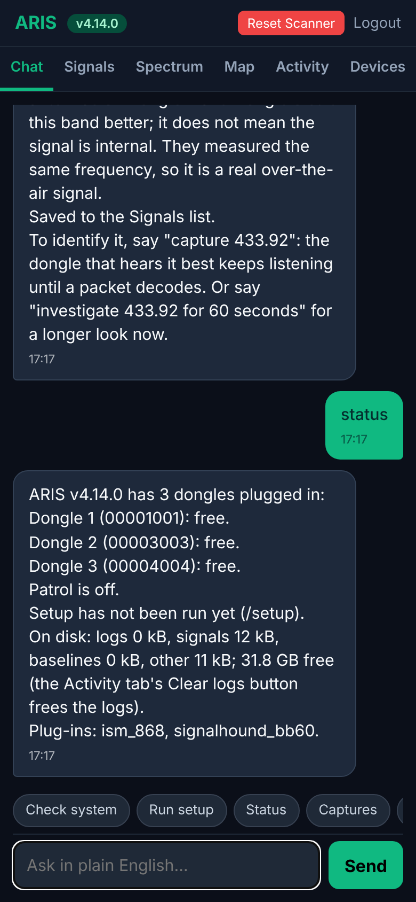
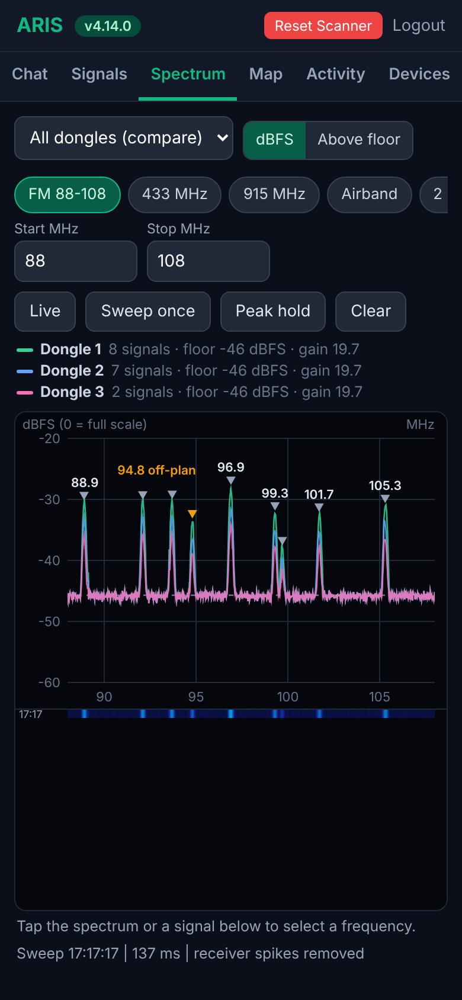
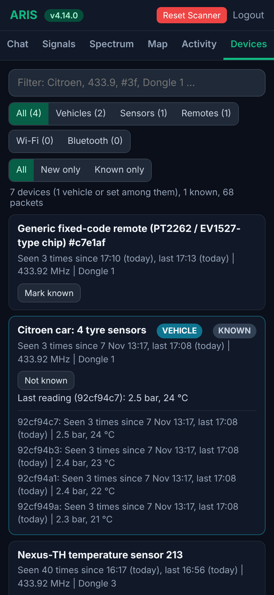
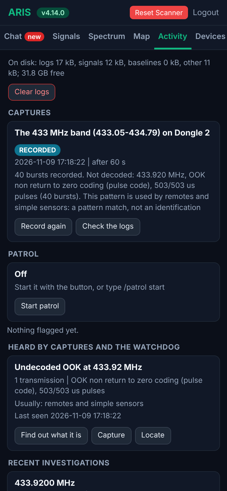
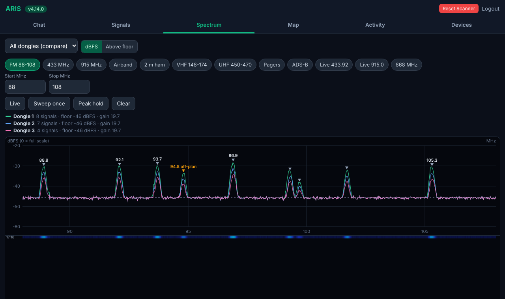

# ARIS

**A receive-only radio monitoring station that runs on your own computer. Use it from any browser: on the computer
itself (`http://localhost:5000`), or from a phone, tablet or laptop on your network.**

ARIS watches the radio spectrum with one or more software-defined radios, finds what is transmitting, identifies the
devices a decoder can recognise (weather sensors, tyre-pressure sensors, remotes, FM stations, pagers, aircraft),
records whole ISM bands burst by burst, flags transmitters that are new, and estimates where a transmitter is on a
floorplan. Everything runs offline, including the AI chat (a local model through Ollama). It never transmits, and it
keeps metadata only.

<p align="center">
  
  
  
  
</p>
<p align="center">
  
</p>

*Screenshots from the built-in simulator (no radios attached), at phone width and on a desktop browser:
`bash test/run_all.sh --shots` makes them again.*

## What it does

- **Spectrum**: live sweeps from every receiver at once (overlaid, each against its own noise floor), peak lists,
  waterfall, presets for common bands, and true dBFS levels.
- **Investigate and decode**: listen on a frequency for up to 10 minutes on every receiver; rtl_433's 200+ device
  decoders, FM station names (RDS, decoded and checksummed by ARIS itself), pager and APRS metadata, ADS-B aircraft
  (checksum-verified only). Anything a decoder does not recognise is described by what was measured, never guessed.
- **Band capture**: records a whole band (433 MHz, 902-928 MHz, or any range up to 60 MHz), finds every burst in time
  and frequency, cuts it out and decodes it, so devices that transmit for a few milliseconds are not missed.
- **Devices**: everything decoded, grouped (a car's tyre sensors as one row, passing cars apart from the ones that
  come back), with "known" devices folded away so new ones stand out. A passive Wi-Fi view and a Bluetooth view
  (with an Ubertooth One) list what access points and advertisers announce.
- **Patrol and threat levels**: scheduled sweeps against each receiver's own baseline; a new continuous transmitter
  is investigated automatically.
- **Locate**: signal-strength readings from several receivers (local dongles or remote nodes on the network) give a
  heat map of where a transmitter probably is, on your own floorplan.
- **Chat**: ask in plain words ("scan the 433 band", "what devices have you seen", "capture 1090"). Common requests
  are answered directly; open questions go to a local AI model that can only use ARIS's own tools.
- **Reset Scanner**: one button stops everything and frees every receiver.

## Receivers

| Kind | How | Status |
|---|---|---|
| RTL-SDR dongles (RTL2832U with R820T / R828D / E4000 ...) | the rtl-sdr tools | used daily |
| Any SoapySDR receiver: HackRF, Airspy, SDRplay, LimeSDR, PlutoSDR, USRP, SoapyRemote ... | SoapySDR + [rx_tools](https://github.com/rxseger/rx_tools) | tested in simulation |
| Signal Hound BB60C / BB60D | the bundled plug-in `plugins/signalhound_bb60.py` with Signal Hound's BB API | tested in simulation |
| Anything else that can stream IQ | a device plug-in (one Python file) | see [docs/PLUGINS.md](docs/PLUGINS.md) |

Receivers are found when ARIS starts and by `/check`; nothing is hard-coded. Mix and match: each receiver gets its own
gains, frequency correction and baselines, and ARIS works out which one hears each band best. Details:
[docs/DEVICES.md](docs/DEVICES.md).

## Quick start

Try it without any radio, in the simulator:

```
pip install numpy flask werkzeug ollama pytest
python3 test/serve.py 5097          # then open http://127.0.0.1:5097  (login: admin / test-password-123)
```

Install it for real (Linux, systemd; runs as its own unprivileged user `aris`, never as root):

```
sudo apt install rtl-sdr rtl-433 multimon-ng        # plus SoapySDR / rx_tools for other receivers
git clone https://github.com/bradderz143/ARIS-RF.git aris && cd aris
sudo bash deploy/install.sh                          # dry run: checks everything, changes nothing
sudo bash deploy/install.sh --apply                  # installs to /opt/aris, data in /var/lib/aris
sudo -u aris env ARIS_DATA_DIR=/var/lib/aris python3 /opt/aris/aris_gui.py --set-password
```

Open `http://localhost:5000` on the computer itself, or `http://<the computer's address>:5000` from another device
on your network, then in the chat: **/check** (finds and tests the receivers and decoders,
changes nothing) and **/setup** (calibrates each receiver: gains, frequency correction, which one hears which band
best; a few minutes). For the AI chat, install [Ollama](https://ollama.com) and `ollama pull qwen2.5:7b` (any model
with tool calling works; set `ARIS_MODEL`). Updates: `sudo bash /opt/aris/deploy/update.sh`.

Keep the web page off your network if you do not need it there: set `ARIS_GUI_HOST=127.0.0.1`, and reach it through
SSH or `deploy/tailscale-https.sh` (HTTPS inside your own tailnet).

## Plug-ins

A plug-in is one Python file in `plugins/` (or `$ARIS_DATA_DIR/plugins/`). It can add a receiver type, chat tools
and decoders, and named bands (scans, band captures and Spectrum presets understand them). Two come with ARIS:
`signalhound_bb60.py` (a receiver type) and `ism_868.py` (the 863-870 MHz band, as a short example). See
[docs/PLUGINS.md](docs/PLUGINS.md).

## Rules it keeps

- **Receive-only.** No feature transmits, and nothing may be added that does.
- **Metadata only.** No voice or audio is recorded, kept or transcribed; decoders get audio in memory and it is
  deleted at once. Encrypted or private traffic is never unpacked.
- **No replayable codes.** Remote-control and rolling codes are stripped from every log, reply and record; remotes
  are shown by a keyed label, and recorded bursts are never kept on disk.
- **Honest verdicts.** "Identified" only when a decoder recognised the device's own data; a pattern match is
  called a pattern match; locate results are a rough area, never a spot.

Listening to the radio spectrum is regulated differently in each country, and intercepting private communications
is a crime in most. **Check your local law before you use ARIS**, and use it only where and how you are allowed to.

## Layout

| Path | What |
|---|---|
| `aris.py`, `engine/` | the engine: sweeps, investigations, decoding, captures, band capture, patrol, setup, chat |
| `arislib/` | engine-independent pieces (numpy only): receivers, RDS, burst detection, devices, locate maths |
| `aris_gui.py`, `arisweb/` | the web page: Chat, Signals, Spectrum, Map, Activity, Devices |
| `aris_node.py` | a remote node: another computer with a receiver, for locating |
| `plugins/` | plug-ins loaded at start |
| `deploy/` | installer, update, systemd units, the passive Wi-Fi and Bluetooth helpers |
| `test/` | simulated radios and the automated tests: `bash test/run_all.sh` |
| `docs/` | how it works ([ARCHITECTURE](docs/ARCHITECTURE.md)), receivers, plug-ins, development |

Settings, logins, node tokens, databases, baselines and logs live in the data folder (`$ARIS_DATA_DIR`, default
`~/aris_data`; `/var/lib/aris` for the service), never in the repository.

## Licence

MIT: see [LICENSE](LICENSE). The licence covers ARIS's own code; the programs it runs (rtl-sdr, rtl_433,
SoapySDR, rx_tools, multimon-ng, Ollama, Signal Hound's BB API) keep their own licences and are installed separately.
